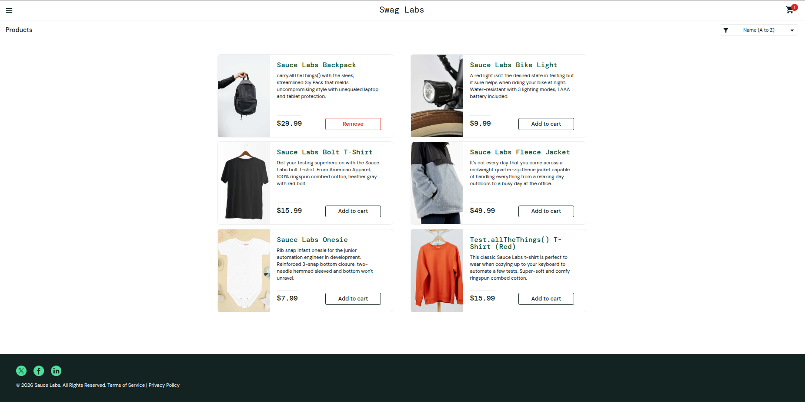
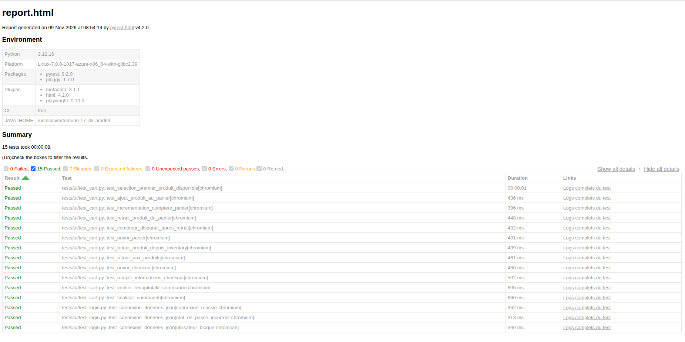

# QA Automation Framework

[](https://github.com/HMD91/qa-automation-framework/actions/workflows/ci.yml)


A professional UI test automation framework built with Python, Pytest and Playwright.


## Overview

This project is a UI test automation framework designed to validate the main user journeys of a web application.

It uses the Page Object Model (POM) design pattern to separate test logic from page interactions.

The framework currently automates:
- User authentication
- Product selection and cart management
- Checkout process
- Order confirmation


## Tech Stack

- **Python 3.12+** — Programming language
- **Playwright** — Browser automation
- **Pytest** — Test framework and test execution
- **pytest-playwright** — Playwright integration with Pytest
- **pytest-html** — HTML test reporting
- **Ruff** — Code quality and linting
- **Git & GitHub** — Version control and source code hosting
- **GitHub Actions** — Continuous Integration (CI)


## Project Structure

```text
qa-automation-framework/
│
├── config/                  # Project configuration
│
├── framework/
│   ├── ui/                  # Page Object Model classes
│   ├── api/                 # API automation module (planned)
│   └── utils/               # Shared utilities
│
├── tests/
│   ├── conftest.py          # Shared fixtures and Pytest hooks
│   └── ui/
│       ├── test_login.py    # Authentication tests
│       └── test_cart.py     # Cart and checkout tests
│
├── test_data/
│   └── users/
│       └── login_cases.json # Test data
│
├── docs/                    # Project documentation
│
├── .github/
│   └── workflows/
│       └── ci.yml           # GitHub Actions CI pipeline
│
├── reports/                 # Test reports (generated)
├── pyproject.toml           # Project and tool configuration
└── README.md
```


## Installation

### 1. Clone the repository

```bash
git clone git@github.com:HMD91/qa-automation-framework.git
cd qa-automation-framework
```

### 2. Create a virtual environment

```bash
python3.12 -m venv .venv
source .venv/bin/activate
```

### 3. Install project dependencies

```bash
python -m pip install --upgrade pip
pip install -e ".[dev]"
```

### 4. Install Playwright browser

```bash
playwright install --with-deps chromium
```


## Running Tests

### Run all tests

```bash
pytest
```

### Run UI tests only

```bash
pytest tests/ui/
```

### Run a specific test file

```bash
pytest tests/ui/test_login.py
```

### Run tests with detailed output

```bash
pytest -v
```

## Test Reports

After test execution, an HTML report is automatically generated at:

```text
reports/report.html
```

The report is self-contained and can be opened directly in a web browser.


## Continuous Integration (CI)

The project uses **GitHub Actions** to automatically validate code quality and execute automated tests.

The CI pipeline is triggered on:
- Push events to the `main` branch
- Pull requests targeting the `main` branch

### Pipeline Jobs

**1. Code Quality - Ruff**
- Install project dependencies
- Run Ruff to check code quality

**2. Automated Tests - Pytest**
- Install project dependencies
- Install Chromium and its system dependencies
- Execute the automated test suite
- Generate an HTML test report
- Upload the report as a GitHub Actions artifact

The HTML report is available for download for **7 days** after each workflow execution.


## Automated Test Scenarios

The current test suite includes 15 automated UI tests covering the following scenarios:

### Authentication
- Successful login
- Login with an incorrect password
- Login with a locked user account

### Shopping Cart
- Select an available product
- Add a product to the cart
- Verify cart counter increment
- Remove a product from the cart
- Verify cart counter after removal
- Navigate to and from the cart

### Checkout
- Start the checkout process
- Fill in customer information
- Verify the order summary
- Complete an order
- Verify order confirmation

All UI tests are currently executed using Chromium.


## Screenshots

### Inventory Page


### Pytest HTML Report
